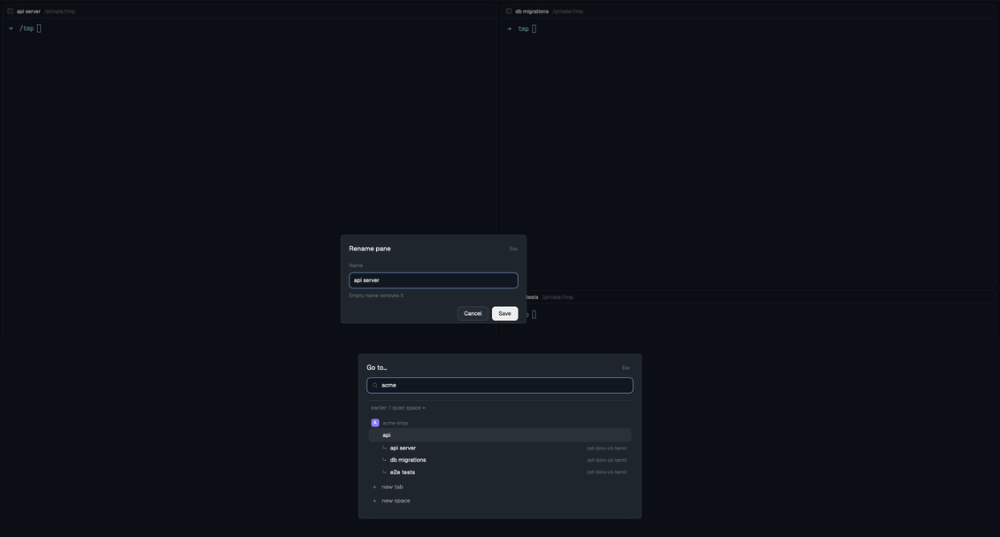

# herdr-pane-names

Pane names for the [Herdr](https://herdr.dev) desktop app: name a terminal pane, see the name in its header,
and find it in Go To. A zoomed pane's header turns the accent color, so you see the zoom at a glance.



## Install

Ask the agent in your Herdr window to add `herdr.dev/mods/smartycoder/herdr-pane-names`, or by hand:

1. Copy `mods/pane-rename`, `mods/pane-named` and `mods/picker-named` to `~/.config/herdr-app/mods/`.
2. Merge `keys.json` into `~/.config/herdr-app/keys.json`: `cmd-p` (Herdr's Go To key) opens `picker-named`
   instead of Herdr's `picker`, `cmd-f2` opens rename. If you moved Go To to another key, point that key at
   `mod.open:picker-named` instead.
3. To show names in pane headers, point your layout's pane header at `pane-named`. Herdr's own layouts are
   read-only, so clone first (`herdr-app do layout.clone '{"name":"main","as":"my-main"}'`), then in
   `~/.config/herdr-app/layouts/my-main.json` find the block with `"tab": "active"` and set its
   `pane.header.content.mod` to `"pane-named"`. If it has no pane header yet, add one under `pane`:
   ```json
   "header": { "content": { "mod": "pane-named" }, "height": 30, "position": "top", "reveal": "always" }
   ```
4. `herdr-app check ~/.config/herdr-app/mods/<name>` for each mod.

Without step 3, names still show in Go To.

## Claude Code sessions

In a Claude Code pane the pane name and the session name stay the same: naming the pane renames the session
(`/rename`), and `/rename` in Claude renames the pane. For that, `pane-named` reads Claude Code's session
registry `~/.claude/sessions/<pid>.json` (never the conversation), and runs `hc get <t> --json`,
`hc send <t> "/rename <name>"` and `hc label`. If you have an unfinished prompt in Claude, the rename waits
until you send or clear it. Nothing leaves your computer.

How it works and how to rebuild it: [RECIPE.md](RECIPE.md).

## License

Apache License 2.0. `pane-named` and `picker-named` are modified from mods shipped with Herdr; see
[NOTICE](NOTICE).
