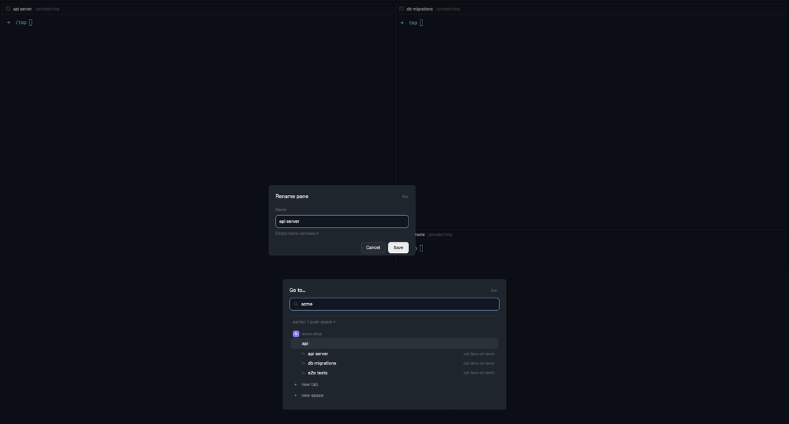

# Pane names

Name any terminal pane ("api server", "db migrations") and find it again. The name replaces the program
name in the pane header ("Claude Code", "zsh"), and Go To lists every named pane under its tab, searchable,
with Enter jumping straight to that pane, also in another tab or space. A zoomed pane's header turns the
accent color and says so, with its unzoom button always shown. In a Claude Code pane, the pane name and the
session's name (Claude's `/rename`) stay the same.

## What you see

- **Pane header** (`pane-named`): the same 30 px header as Herdr's `pane` mod (program icon, name, folder,
  agent status, hover buttons), but the name slot shows the pane's name when it has one. A zoomed pane's
  header has an accent tint (`theme().accent` + `38`), a 2 px accent line on its terminal-facing edge (1 px
  `border` otherwise), the folder in `foreground` + `c0`, and at the right an 18 px accent badge (radius 5,
  10.5 px semibold `accent_foreground`, the 11 px `zoom` icon) reading "Zoomed · 2 hidden" (the other panes
  of its tab; "Zoomed" when it has none), then the `unzoom` button in `foreground`.
- **Rename dialog** (`pane-rename`): a 420 × 200 px dialog titled "Rename pane", one "Name" field prefilled
  with the current name and selected, the hint "Empty name removes it", Cancel and Save buttons, "Esc" in the
  top right. Same look as Herdr's `prompt` dialog (theme colors `popover`, `accent`, `solid`). It is modal:
  a click beside it doesn't close it.
- **Go To** (`picker-named`): Herdr's Go To popup (640 px wide, top, offset 40) with one more row kind: under
  each tab, every named pane as a 28 px row `↳ <name>`, indented 32 px, with the program name dimmed on the
  right. Placeholder: "Go to a tab, pane, space or agent…".

## How it behaves

- The name lives on the terminal as the herdr-core label `pane.name`. Any Herdr window and the CLI see it
  (`hc get t3`), an agent can set its own (`hc label t3 pane.name="api server"`), and it ends with the
  terminal.
- Names are trimmed when written and when read: a label of only spaces (set by hand or by an agent) counts as
  no name.
- `cmd-f2` opens the dialog for the focused pane; double-clicking the name in a pane header opens it for that
  pane. Enter or Save writes the trimmed name, an empty name removes the label (`hc label <t> pane.name=`), an
  unchanged name just closes, Esc or Cancel closes without writing. While a save runs, Enter, Save, Esc and
  Cancel wait for it. A failed write shows an error toast "Rename failed" and keeps the dialog open with the
  typed name.
- Zoom (`cmd-shift-enter`, `pane.zoom`): the zoomed pane's header shows the badge and keeps the unzoom
  button shown without hover; a click on it runs `pane.zoom {pane}` and the header goes back to normal. The
  hover buttons then leave out the zoom button, so the header never has two. Mod panes zoom and show it too.
- Claude Code panes on this computer (`app` or `agent` is `claude-code`) keep the two names the same, on a
  change only: a pane and a session that already differ stay as they are until one is renamed.
  - A new pane name (dialog, double-click, `hc label`) is typed into Claude as `/rename <name>` with
    `hc send`, unless the session already has that name. `hc send` waits while the person has an
    unfinished prompt in Claude; after 3 s the info toast "Claude session renames after your prompt" says
    so, and the rename runs once the prompt is sent or cleared. A failed send shows the warning toast
    "Claude session not renamed". Removing the pane name leaves the session's name alone.
  - A name given in Claude (`/rename`, `--name`) becomes the pane name within about a second; names Claude
    makes up itself (`derived`, `auto`) never do.
  - The rename dialog's hint reads "Renames the Claude session too · empty removes the name" for such a
    pane when the shown layout uses `pane-named`.
- A mod pane (Files, Changes) has no terminal: `cmd-f2` there shows the warning toast "This pane has no
  terminal" and closes the dialog at once.
- Go To with an empty filter shows every named pane under its tab; as in Herdr's picker, tabs of quiet spaces
  (no agent running) stay folded under "earlier" until expanded or filtered. The filter is trimmed. A tab
  matches on its space name, tab name, agent programs and its terminals' titles (e.g. a Claude Code session
  title); a named pane shows when its name matches or its tab matches. The selection goes to the first row
  that matches by itself, and a named pane under a matching tab wins over the tab; after that it stays on the
  same row while live titles and statuses reorder the list. Enter or click on a pane row runs `tab.select`,
  then `pane.focus`. `ctrl+d` closes a tab row as before and does nothing on a pane row.
- Agent statuses (working, blocked, done, idle) look exactly as in Herdr's `pane` and `picker`.

## Built from

- `mods/pane-rename`: new. `mod.json` overlay `{ "kind": "dialog", "width": 420, "height": 200, "modal": true }`.
  Target is `props().terminal`, else `focused().terminal` read once in `init`. `label.js` (pure):
  `readLabel(terminals, address)` and `nextLabel(typed, before)` (null = nothing to write). Writes with
  `hc(["label", terminal, "pane.name=" + name])` and closes only after a successful write.
- `mods/pane-named`: `mod.clone pane`, name slot `label || <Herdr's name>` where the label is the trimmed
  `terminals().find((t) => t.address === pane.terminal)?.labels?.["pane.name"]`; the name `div` has
  `on_mouse_down("left")` with `click_count === 2` → `openOverlay({ mod: "pane-rename", kind: "dialog",
  width: 420, height: 200, modal: true, props: { terminal } })`. `zoom.js` (pure): `zoomBadge(panes, pane)`
  returns the badge text from `panes()`, or null when the pane is not zoomed. `sync.js` (pure):
  `userName(registryText)` (the name only when `nameSource` is `"user"`), `renameText(label, sessionName)`
  (`/rename <name>` or null), `pullLabel(label, sessionName)` (the new pane name or null). `init` starts
  `cx.timer.every(1000)`, which compares the pane's label and terminal title with the last tick and, on a
  change, finds the session: `hc get <t> --json` → `foreground.pid` → `~/.claude/sessions/<pid>.json`. A
  changed label pushes (`hc send`), a changed title pulls (`hc label`); one sync at a time.
- `mods/picker-named`: `mod.clone picker` plus `names.js` (pure, no Herdr import): `tabMatch(...)` decides a
  tab's own match and its named pane rows (from all `terminals()`, as the header reads them), `firstPick(rows)`
  the row selected while filtering, `rowKey(row)` the identity the selection follows.
- Tests (Node 22.7 or newer for module detection; tested on Node 24.15), in each mod folder:
  `node --disable-warning=MODULE_TYPELESS_PACKAGE_JSON --test label.test.mjs` (pane-rename),
  `... --test zoom.test.mjs` and `... --test sync.test.mjs` (pane-named), and `... --test names.test.mjs`
  (picker-named).
- Hook-up, outside the mods:
  - `keys.json`: `cmd-p` (Herdr's own Go To key) → `mod.open:picker-named`, `cmd-f2` → `mod.open:pane-rename`.
  - Each layout that should show names in pane headers: in its tab block (`"content": { "tab": "active", ... }`)
    set `pane.header.content.mod` to `"pane-named"`, or add
    `"header": { "content": { "mod": "pane-named" }, "height": 30, "position": "top", "reveal": "always" }`
    under `pane` if the layout has no pane header. Herdr's own layouts are read-only: `layout.clone` first and
    edit `layouts/<clone>.json`.
  - Only the Go To key opens `picker-named`; the Terminals layout's space chip and `main`'s sidebar search keep
    opening Herdr's own picker.
- Commands used: `tab.select`, `pane.focus`. Program run: `hc label`.

## Watch out

- Every `mod.json` must keep `"place": "none"`, or Herdr docks the mod into the shown layout on first sight.
- A mod cannot change a layout, so without the header hook-up names show only in Go To.
- `pane-named` and `picker-named` are clones of Herdr 0.1.15's mods and don't get Herdr's later fixes;
  compare with the shipped `pane` and `picker` after an upgrade.
- Keys are macOS (`cmd`); on Linux and Windows pick free `ctrl-shift` keys instead. Merging `keys.json`
  replaces Herdr's `cmd-p` → `mod.open:picker`; if the person moved Go To to another key, rebind that key
  instead. `cmd-f2` is unbound in Herdr.
- The label key is `pane.name`; never write `herdr.*` labels.
- Names on remote machines' terminals are untested: `hc label` gets the `machine/t7` address as Herdr gives it.
  Their Claude sessions are not synced: the session registry is on that machine.
- `hc send` run inside a terminal wraps the text as a message from that terminal (`<hc from="t46">…</hc>`), so
  Claude gets `/rename` as a prompt for the model, not as a command. Run it from the mod (the app's `hc`),
  never from a script in a terminal.
- `hc send` waits only for a prompt the person typed in Herdr. Keys a program pressed (`hc keys`) don't count:
  then the text is pasted after them and sent as one message.
- The sync runs only in panes on screen: a pane in a background tab catches up on its next change after it
  shows. Only `~/.claude` is read, not another `CLAUDE_CONFIG_DIR`.

## Done when

1. `herdr-app check` passes for all three mods; all four test files are green.
2. `cmd-f2` on a terminal pane, type "api server", Enter: `hc get <t>` shows `pane.name: api server` and the
   pane header shows it.
3. From another tab, `cmd-p`, type "api server": the `↳ api server` row is selected; Enter focuses that pane.
4. Double-click the name in the header, clear it, Save: `hc get <t>` has no `pane.name` and the header shows
   the program name again.
5. `cmd-f2` on a Files pane: warning toast, the dialog closes at once.
6. In a tab with 3 panes, `cmd-shift-enter`: the header turns the accent color and reads "Zoomed · 2 hidden";
   a click on its unzoom button brings back all 3 panes and the plain header.
7. In a Claude Code pane with an empty prompt, `cmd-f2`, type "api server", Enter: Claude shows "Session
   renamed to: api server" and `~/.claude/sessions/<pid>.json` has `"name": "api server", "nameSource": "user"`.
8. In that Claude, `/rename db work`: within about a second the header shows "db work" and `hc get <t>` shows
   `pane.name: db work`.
